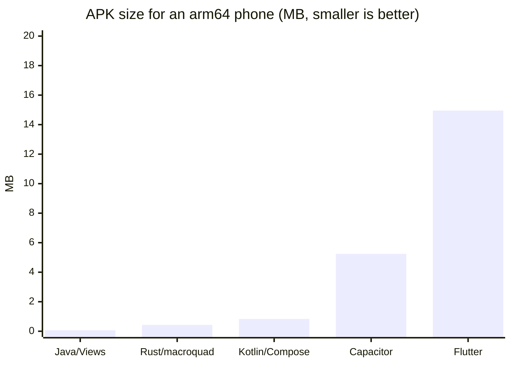
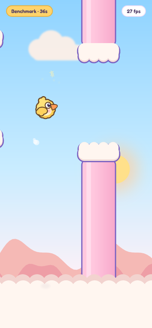
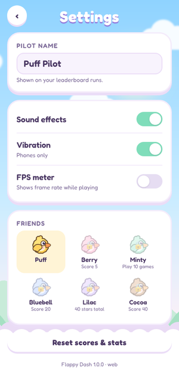

<div align="center">


# Flappy Dash

**A soft, fluffy one-tap flyer, built in six frameworks to see what each one costs.**


**[⬇ Download builds (Releases)](../../releases)** · **[▶ Play on the web](https://flappy-dash.expo.app)** · **[📏 How to measure on your phone](docs/MEASURING.md)**

</div>

---

## The cost of each framework at a glance

Android APK for one **arm64** phone, release build, the same game in each:



| | Framework | Language | Renders with | APK (arm64) | Universal APK | Web download |
|---|---|---|---|---:|---:|---:|
|  | **Java + Android Views** | Java | Android Canvas (Skia inside the OS) | **0.07 MB** | 0.07 MB | – |
|  | **Rust + macroquad** | Rust | OpenGL ES | **0.43 MB** | 4 × ≈0.45 MB | **0.54 MB** |
|  | **Kotlin + Jetpack Compose** | Kotlin | Compose Canvas | **0.83 MB** | 0.83 MB | – |
|  | **Capacitor** (Expo web in a WebView) | TS/React | system WebView + CanvasKit | **5.24 MB** | 5.24 MB | (same as Expo web) |
|  | **Flutter** | Dart | Impeller/Skia (bundled engine) | **14.95 MB** | 41.8 MB | 7.36 MB |
|  | **Expo / React Native** | TS/React | react-native-skia + Reanimated | ⏳ *(EAS build running)* | 141.8 MB | 10.79 MB |

<sub>Sizes are measured from the actual release files (`bench/apk-size.py`). Universal APK = one file for all CPU types (arm64, armv7, x86_64, x86). Web download = bytes a first-time visitor loads, uncompressed (`bench/web-transfer.cjs`). Java and Kotlin need no native code, so one tiny APK covers every CPU.</sub>

### Where the megabytes go (arm64)

| Framework | Biggest parts |
|---|---|
| Expo / React Native | `librnskia.so` **13.7 MB** · `libreactnative.so` 6.7 MB · `libhermesvm.so` 2.6 MB · Reanimated + Worklets 2.8 MB · Expo modules 1.5 MB · JS bundle (Hermes bytecode) ≈ 4.6 MB raw |
| Flutter | `libflutter.so` (engine) **10.8 MB** · `libapp.so` (our Dart code, AOT) 3.1 MB |
| Capacitor | web assets 4.1 MB (CanvasKit wasm + JS bundle) · dex 0.45 MB. The engine is the phone's own WebView, so it isn't counted |
| Kotlin + Compose | dex 0.6 MB (Compose runtime after R8 shrinking) |
| Rust + macroquad | `libflappy_dash.so` **0.37 MB**: game + renderer + windowing in one library |
| Java + Views | 10 KB of code; the rest is the launcher icon |

**What this tells you:** the Expo app is big because of **what it brings**, not because of Expo itself. Skia alone is 14 MB per CPU type, and React Native + Hermes adds ~10 MB. Expo's own modules are about 1.5 MB. Without Skia, this app's arm64 native libraries would be about 21 MB instead of 35 MB. Play Store users download only their CPU's slice (from the `.aab`), never the 142 MB universal file.

## Performance

### Measured here (same headless Chromium, same 30 s autopilot course)

This container has no GPU and no Android emulator, so this compares the **web builds** with software rendering. Read it relatively; the absolute fps is low for every build.

| Web build | fps | Main-thread JS | JS heap | Renderer RAM | First load |
|---|---:|---:|---:|---:|---:|
|  Rust (wasm + WebGL) | **52.8** | 2.3 % | 1.3 MB | 136 MB | 0.54 MB |
|  Flutter web (CanvasKit) | 25.6 | 98.4 % | 19.5 MB | 205 MB | 7.36 MB |
|  Expo web (RN Web + Skia CanvasKit) | 12.8 | 4.0 % | 13.5 MB | 181 MB | 10.79 MB |

<sub>`bench/web-bench.cjs`, raw data in `bench/results/web-headless-chromium.json`. On the web, Expo and Flutter both draw through CanvasKit (Skia compiled to WebAssembly) running on a software GPU, which is the bottleneck here. Rust/macroquad issues a few hundred cheap WebGL calls per frame.</sub>

### On your phone (the numbers that matter)

Every build has the **same built-in benchmark**: a seeded 60-second autopilot run on the identical course (seed 1234). It reports avg fps, 1 % low, p50/p95/p99 frame time and dropped frames. The engines are line-by-line ports and are checked against each other by tests, so every framework draws exactly the same frames.

| Build | How to start the benchmark |
|---|---|
| Expo | Settings → **Run benchmark** → *Share results* |
| Kotlin, Java, Flutter, Rust | **Benchmark (60 s)** button on the start screen |

RAM, CPU, cold start and frame stats over wireless ADB from Windows: see **[docs/MEASURING.md](docs/MEASURING.md)** and `scripts/measure-android.ps1`.

## The game

| | |
|---|---|
| 🐤 **6 fluffy friends** | Puff, Berry, Minty, Bluebell, Lilac, Cocoa, unlocked by score, games played or stars |
| ☁️ **Cotton candy towers** | Gaps narrow and speed rises up to score 45; from the 8th tower some gaps drift |
| ⭐ **Stars** | About 1 in 3 gaps holds a star worth +1 |
| 🌅 **4 skies** | Morning → Sunset → Twilight → Starry, crossfading every 10 points |
| 🏆 **Leaderboard** | Top 25 runs on the device with name, character, stars and date, plus lifetime stats and ribbons |
| 🔊 **Sound + haptics** | Synthesised soft effects that mix with your music |

The Expo app is the full game (menus, leaderboard, characters, settings). The ports implement the game, the art, best score and the benchmark (see [ports/SPEC.md](ports/SPEC.md)).

<div align="center">
   
</div>

### Why the Expo version is smooth now

The first version re-rendered the whole React tree and ~100 SVG views 60 times a second from the JS thread. Now:

- each frame is **one Skia picture recorded on the UI thread** (`useFrameCallback` + worklets),
- input is a **touch-down gesture worklet**, so a flap never waits on JavaScript,
- React re-renders only on events (score, crash, theme change),
- physics runs at a **fixed 120 Hz step** (same feel on 60/90/120 Hz screens), and
- pillars and particles use **fixed-size pools** (no garbage per frame).

## Downloads (GitHub Releases)

| Platform | Files |
|---|---|
| Android phone (arm64, almost every phone) | `expo-android-arm64-v8a.apk`, `flutter-android-arm64-v8a.apk`, `rust-android-arm64-v8a.apk`, `kotlin-compose-android.apk`, `java-views-android.apk`, `capacitor-android.apk` |
| Android, other CPUs | `*-armeabi-v7a.apk` (old 32-bit), `*-x86_64.apk` / `*-x86.apk` (emulators), `*-universal.apk` (all) |
| Play Store | `*.aab` (not installable directly) |
| iOS | `*-ios-simulator.*` (Xcode Simulator), `*-ios-device-unsigned.ipa` (size reference only; needs signing to install) |
| Desktop | `flutter-windows-x64.zip`, `flutter-macos.zip`, `flutter-linux-x64.tar.gz`, `rust-windows-x64.exe`, `rust-macos-arm64`, `rust-linux-x64` |
| Web | <https://flappy-dash.expo.app>, `expo-web.zip`, `flutter-web.zip`, `rust-web.zip` |

Each port has its own package id (`com.flappydash.kotlin`, `…java`, `…flutter`, `…rust`, `…capacitor`; Expo is `com.flappydash.game`), so they install side by side.

## Repository layout

```
src/                  Expo app (Expo Router screens, Skia renderer, engine, store, sfx, UI kit)
assets/               icons, splash, synthesised sound effects
ports/
  SPEC.md             rules every port follows (identical physics, RNG and autopilot)
  kotlin-compose/     Kotlin + Jetpack Compose (Android)
  java-views/         Java + Android Views (Android, no AndroidX)
  flutter/            Flutter (Android, iOS, web, Windows, macOS, Linux)
  rust-macroquad/     Rust + macroquad (Android, iOS, web, Windows, macOS, Linux)
  capacitor/          Expo web build wrapped by Capacitor (Android, iOS)
bench/                size + web benchmark tools and raw results
docs/MEASURING.md     wireless ADB on Windows: RAM, CPU, frames, cold start
scripts/              asset/sound generators, measure-android.ps1
.github/workflows/    release.yml (Expo: EAS + iOS + web), ports.yml (all ports, all targets)
```

## Develop the Expo app

```bash
bun install          # also copies Skia's canvaskit.wasm into public/ for web
bun start            # dev server; scan the QR code with Expo Go (SDK 58)
bun test             # engine, leaderboard and benchmark-stat tests
bun run typecheck && bunx expo lint
```

Releases: `release.yml` builds every Expo format (EAS Android: universal, 4× per-ABI, AAB; iOS Simulator; unsigned iOS device on a macOS runner; web), and `ports.yml` builds every port for every target. Both attach their files to the same GitHub release.

## Not built yet

Bare React Native (no Expo), Compose Multiplatform, Bevy (Rust engine), .NET MAUI and Tauri would fill in the remaining comparison points. [ports/SPEC.md](ports/SPEC.md) describes exactly what each needs to implement.
